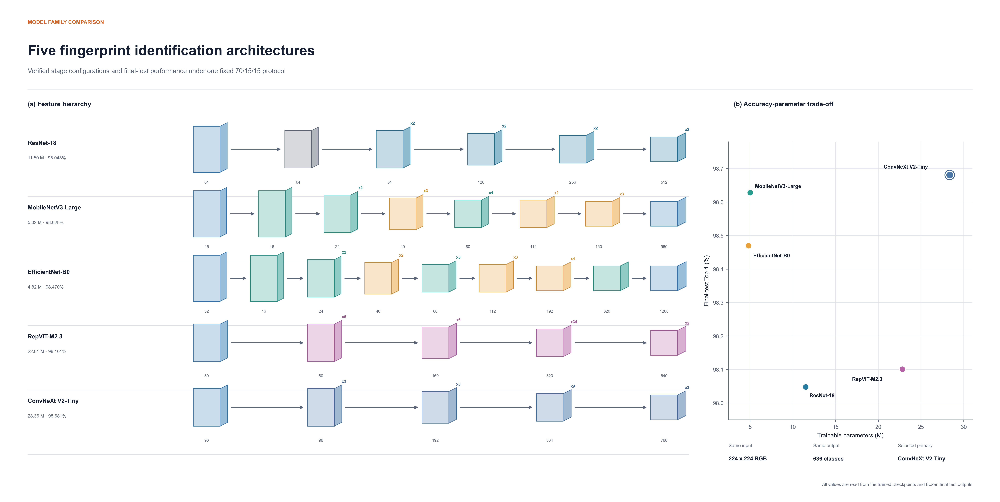
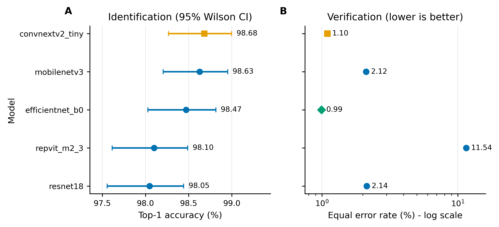
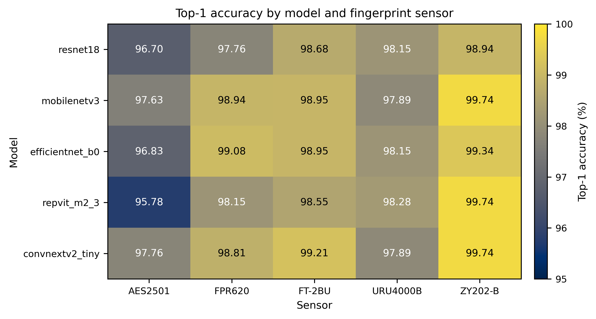
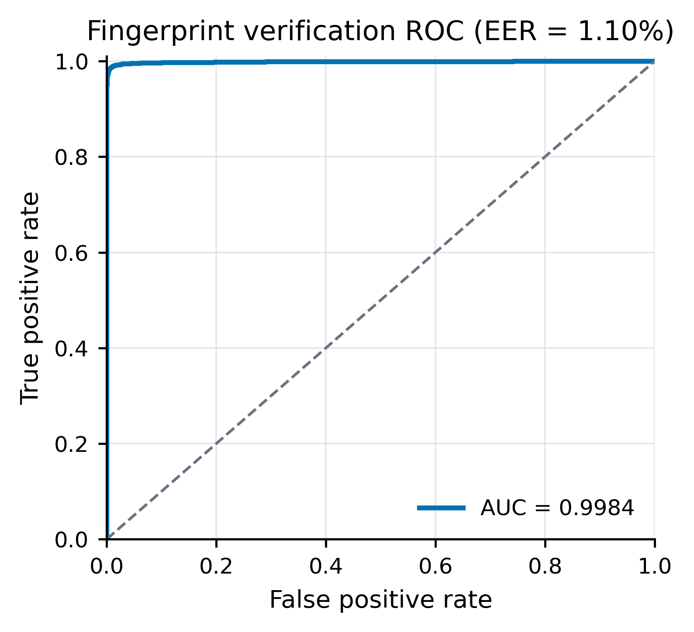

# 多传感器指纹识别

基于 PyTorch 和 timm 的多传感器指纹闭集识别与验证实验。项目在 Multi-Sensor Fingerprint Database 上构建 636 类分类任务，对比 ResNet-18、MobileNetV3-Large、EfficientNet-B0、RepViT-M2.3 和 ConvNeXt V2-Tiny，并使用固定的 70%/15%/15% 协议完成训练、模型选择和一次性最终测试。

> 仓库不包含指纹原图、课程报告、模型权重、逐样本预测、训练日志或任何个人信息。

## 项目特点

- 使用 SHA-256 检测完全重复图像，并排除标签冲突的重复样本。
- 固定随机种子 `20261010`，划分 70% 训练集、15% 验证集和 15% 测试集。
- 训练阶段不读取测试集，只有显式添加 `--allow-final-test` 才能执行最终测试。
- 统一比较五种卷积与移动端视觉架构，输出 Top-1、Top-5、Macro-F1、ROC-AUC 和 EER。
- 同时报告各传感器准确率、636 类混淆矩阵、训练曲线和验证分数分布。
- 提供架构图生成与审计脚本，用真实 timm 模块和检查点核对参数量、阶段深度及特征尺寸。

## 模型结构



所有模型使用 `224 x 224` 三通道输入和 636 类输出。分类头之外的特征向量用于 1:1 指纹验证。

## 实验结果

最终测试集包含 3,791 张图像，占清洗后数据的 15.001%。以下结果来自同一数据划分、同一随机种子和一次性最终测试。

| 模型 | 参数量 | Top-1 | Top-5 | Macro-F1 | ROC-AUC | EER |
|---|---:|---:|---:|---:|---:|---:|
| ConvNeXt V2-Tiny | 28.36 M | **98.681%** | 99.499% | **0.9867** | 0.998439 | 1.097% |
| MobileNetV3-Large | 5.02 M | 98.628% | 99.525% | 0.9861 | 0.997406 | 2.116% |
| EfficientNet-B0 | 4.82 M | 98.470% | 99.472% | 0.9844 | **0.999170** | **0.992%** |
| RepViT-M2.3 | 22.81 M | 98.101% | 99.420% | 0.9810 | 0.948248 | 11.538% |
| ResNet-18 | 11.50 M | 98.048% | **99.578%** | 0.9803 | 0.997624 | 2.137% |



ConvNeXt V2-Tiny 的闭集识别准确率最高，EfficientNet-B0 的验证 ROC-AUC 和 EER 最优。两类指标面向不同任务，不应只根据单一数值选择模型。

### 跨传感器结果



五种模型在 AES2501 上的准确率整体较低，在 ZY202-B 上整体较高，说明采集设备仍然是影响识别性能的重要因素。

### ConvNeXt V2-Tiny 验证结果



## 数据集约定

数据集根目录应包含五个传感器文件夹：

```text
Multi-Sensor Fingerprint Database/
├─ AES2501/
├─ FPR620/
├─ FT-2BU/
├─ URU4000B/
└─ ZY202-B/
```

每个传感器目录下包含 `001` 至 `106` 的受试者目录，每名受试者包含 6 根手指、每根手指 8 次采集。文件名格式为 `手指编号_采集编号.bmp`，例如 `1_1.bmp`。

原始数据共 25,440 张图像。哈希去重和冲突标签排除后保留 25,271 张，形成 636 个类别：

```text
类别 = 受试者编号 x 手指编号
106 名受试者 x 6 根手指 = 636 类
```

数据集不随仓库分发。请在合法获得数据后，通过 `--data-root` 指定数据集根目录。所有脚本使用同一个根目录，清单中的路径均相对于该目录。

## 目录结构

```text
.
├─ fingerprint_exp/
│  ├─ data.py                      # 数据集、预处理和 DataLoader
│  ├─ models.py                    # 五种 timm 模型和特征提取
│  ├─ plots.py                     # 训练、识别和验证结果绘图
│  └─ utils.py                     # 随机种子、哈希和 Top-k 统计
├─ scripts/
│  ├─ build_manifest.py            # 去重、审计和 70/15/15 划分
│  ├─ train.py                     # 训练与验证集模型选择
│  ├─ summarize_validation.py      # 汇总验证集结果
│  ├─ evaluate.py                  # 一次性最终测试
│  ├─ summarize_results.py         # 汇总模型和传感器结果
│  ├─ regenerate_figures.py        # 从保存的数值结果重新绘图
│  ├─ smoke_test.py                # 数据和模型接口检查
│  ├─ generate_architecture_diagrams.py
│  └─ audit_architecture_diagrams.py
├─ docs/assets/                    # README 使用的非敏感结果图
├─ requirements.txt
└─ README.md
```

## 环境安装

建议使用 Python 3.11 和支持 CUDA 的 PyTorch 环境。

```bash
python -m venv .venv

# Linux / macOS
source .venv/bin/activate

# Windows PowerShell
.venv\Scripts\Activate.ps1

pip install -r requirements.txt
```

主要依赖包括 PyTorch、torchvision、timm、scikit-learn、pandas、NumPy、Matplotlib 和 Pillow。

## 复现实验

以下命令均在仓库根目录执行。将 `<DATASET_ROOT>` 替换为 Multi-Sensor Fingerprint Database 的实际路径。

### 1. 构建清单并划分数据

```bash
python scripts/build_manifest.py \
  --data-root "<DATASET_ROOT>" \
  --output-dir splits \
  --hash-files \
  --seed 20261010
```

脚本将生成：

- `manifest.csv`：清洗后的图像路径、标签、传感器和数据划分。
- `excluded_images.csv`：被排除的重复或冲突样本。
- `duplicate_hash_groups.json`：重复哈希组。
- `integrity_audit.json`：数量、类别、传感器和泄漏检查结果。

### 2. 快速接口检查

```bash
python scripts/smoke_test.py \
  --manifest splits/manifest.csv \
  --data-root "<DATASET_ROOT>"
```

### 3. 训练模型

```bash
python scripts/train.py \
  --manifest splits/manifest.csv \
  --data-root "<DATASET_ROOT>" \
  --model convnextv2_tiny \
  --output-dir outputs/convnextv2_tiny/seed_20261010 \
  --seed 20261010
```

可选模型：

```text
resnet18
mobilenetv3
efficientnet_b0
repvit_m2_3
convnextv2_tiny
```

默认配置为 35 个 epoch、batch size 128、AdamW、学习率 `3e-4`、权重衰减 `0.05`、标签平滑 `0.1`、两轮 warmup、余弦退火和 patience 8 早停。

### 4. 汇总验证集结果

```bash
python scripts/summarize_validation.py \
  --outputs-root outputs \
  --output-dir outputs/validation_comparison
```

应先使用验证集完成模型和超参数选择，再冻结选择结果。此阶段不访问测试集。

### 5. 一次性最终测试

```bash
python scripts/evaluate.py \
  --manifest splits/manifest.csv \
  --data-root "<DATASET_ROOT>" \
  --checkpoint outputs/convnextv2_tiny/seed_20261010/best.pt \
  --output-dir outputs/convnextv2_tiny/seed_20261010/final_test \
  --allow-final-test
```

`--allow-final-test` 是显式保护开关。只有模型和超参数全部冻结后才应使用。

### 6. 汇总最终结果

```bash
python scripts/summarize_results.py \
  --outputs-root outputs \
  --output-dir outputs/comparison
```

## 评估指标

- **Top-1 / Top-5**：636 类闭集指纹识别准确率。
- **Macro-F1**：对所有指纹类别等权平均的 F1。
- **ROC-AUC**：同类和异类指纹对的整体区分能力。
- **EER**：误接受率与误拒绝率相等处的错误率，越低越好。
- **分传感器 Top-1**：检查不同采集设备上的性能差异。
- **95% Wilson CI**：模型 Top-1 准确率的二项分布置信区间。

## 可复现性说明

- 数据划分和负样本对生成均使用固定种子 `20261010`。
- 每个类别在验证集和测试集中均包含五种传感器样本。
- SHA-256 去重在划分之前执行，避免完全相同图像跨集合泄漏。
- 训练只根据验证集 Top-1 保存最佳检查点，测试集不参与模型选择。
- 最终指标由保存的检查点、固定清单和逐样本预测共同确定。

不同 CUDA、cuDNN、GPU 和 timm 版本可能带来轻微数值差异。仓库中的结果是在 NVIDIA RTX 4090 环境下获得的。

## 数据与隐私

本仓库只发布实验代码、复现说明和不含原始指纹的汇总图。请勿提交以下内容：

- 原始或预处理后的指纹图像；
- 受试者信息或逐样本预测明细；
- 模型权重、训练检查点和运行日志；
- 课程报告及其中的个人信息。

数据集的使用与再分发应遵循其原始授权条件。本仓库当前未附加开源许可证，代码默认保留全部权利，仅供课程复现和学术交流参考。

## 技术栈

- Python 3.11
- PyTorch / torchvision
- timm
- scikit-learn
- pandas / NumPy
- Matplotlib / Pillow

## 项目地址

<https://github.com/PerEngineer/multi-sensor-fingerprint-recognition>
